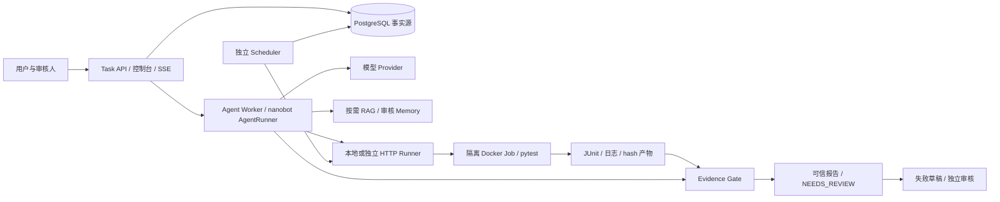

# nanobot 测试 Agent：能力与实现说明

更新日期：2026-10-15。项目名称：**TestPilot**。实现基线：`045f1c6c`。
本文描述当前代码与已记录验证结果；本次文档更新没有新增运行测试或模型调用。

## 1. 当前定位与完成程度

**TestPilot 已具备受控测试任务所需的主要 Agent 基础能力，以及持久恢复、真实执行、证据校验和人工审核能力。TRD 尚未全部完成。**

现在可以让模型在已准入的目标和工具范围内分析信息、提出计划、按需查询知识、主动补问、
执行已审核测试、读取结果，并输出经程序校验的报告。执行失败可进一步生成观察草稿，由独立身份审核。

当前最完整的已验证业务链路是：

> 创建任务 → 模型主动补问 → 所有者补充信息并恢复 → 真实测试执行 → 保留失败结果 →
> 证据校验报告 → 服务端生成失败草稿 → 拒绝自审 → 独立身份批准。

这是可运行、可恢复、可追溯的测试 Agent。目前还没有打通“任意需求 → 自动生成并审核测试代码 →
完整根因诊断 → 自动提交外部缺陷”的全过程，也不能据此宣布企业部署、效果评测和运维验收全部完成。

## 2. nanobot、RAG 与本次二开的分工

| 部分 | 负责什么 | 当前边界 |
|---|---|---|
| 上游 nanobot | AgentRunner 多轮模型/工具循环、模型 Provider、Hook、通用工具和 Skills/MCP 基础设施 | 复用这些能力；测试运行时只注册准入工具，不默认开放全部通用工具权限 |
| qa-kb-service | 知识检索、ACL、版本化知识引用 | TestPilot 按任务和身份调用检索；知识作为背景依据，不直接证明测试通过 |
| TestPilot 二开 | 测试工具、PG 任务、异步 Job、幂等/恢复、审批、隔离执行、证据报告、Memory、控制台和观测 | 核心新增价值集中在测试领域和工程保障；完整业务扩展仍在进行 |

上游具有 SubAgent、多渠道或通用文件/命令工具代码，不等于这些功能已在 TestPilot 中完成治理和验收。

## 3. Agent 基础能力

| 能力 | 已实现行为 | 限制与说明 |
|---|---|---|
| 多轮推理与工具调用 | 模型选择已注册工具，接收观察结果后继续决策 | 已真实调用 DeepSeek `deepseek-flash`；其他 Provider 不代表逐个验收过 |
| 有界规划 | 提交结构化 Plan、保存版本、校验行动范围与最终报告步骤 | 最多 8 步、最多 3 个计划版本；Plan 不会新增执行权限或扩大 Job 预算 |
| 按需检索 | 根据任务查询 qa-kb-service，获取带版本和位置的引用 | 使用服务端绑定的 actor 凭证；检索失败/证据不足不会伪装成已获知识 |
| 主动补问 | `request_input` 提出缺失信息，保存完整工具轮后暂停 | 必须独占工具轮；问题产生后没有新输入时不能直接恢复 |
| 人工介入 | 所有者补充私有说明、暂停/恢复、取消；审核人决策审批 | 输入是待验证信息，不能修改目标、断言、权限或预算 |
| 历史经验 | 查询审核通过、未过期、scope 和代码/环境匹配的失败观察 | 历史经验不能替代当前执行证据，也不是任意聊天内容自动写入经验库 |
| 上下文管理 | 估算模型输入、预留输出预算、有界产物读取、按完整工具组投影历史 | 保留负面/部分事实；保护信息超预算则停止，不能靠截断工具协议继续 |
| 进展控制 | 检测重复观测和 A-B 震荡，持久记录进展 | 停滞时停止或交人工；不是已实现通用反思、自主改写测试策略 |
| 单次报告修复 | 对符合条件的候选格式/声明错误，提供校验缺口并允许一次修复 | 沿用原模型轮数和 deadline，修复期无工具，失败仍进入 NEEDS_REVIEW |
| 执行续跑 | 恢复完整消息、工具调用结果及兼容的 provider 私有状态 | 指纹/版本不兼容或未知写结果时拒绝自动重放；不是任意配置升级无缝续跑 |

因此，“主要基础 Agent 能力已具备”适用于当前受控测试范围；动态工具检索、完整工具治理目录、
测试任务 SubAgent 和开放式测试生成仍未完成。

## 4. 测试业务能力

### 4.1 目标、代码与变更信息

- 支持固定网关策略 fixture，以及操作员审核过的 Git commit/manifest pytest suite。
- Git 路径、blob 内容 hash、planned case 和测试入口固定；读取真实提交对象，脏工作树不参与执行。
- 可读取准入文件的有界代码片段；拒绝未审核路径、symlink/submodule 和内容漂移。
- 可配置只读 GitLab commit/diff/CI 查询，project/Job 由服务端指定并校验 SHA。
- `get_change` 返回审核 manifest 信息；GitLab diff 通过独立工具读取，明确标记分页和覆盖限制。

当前没有自动发现任意仓库、任意测试框架/环境的能力，也没有覆盖率完整性承诺。

### 4.2 真实测试与结果检查

- 通过隔离 Docker Job 实际执行 pytest，保存 JUnit、执行日志及关联记录。
- 固定网关 fixture 用真实 HTTP 请求验证读重试、写不重试、路由优先级和限流。
- Git suite 执行审核文件，依赖须已存在于固定镜像；不在容器中联网安装依赖。
- 按真实 testcase 计算 passed/failed/errors/skipped/not_run，而不只相信汇总计数或模型描述。
- 可读取失败 case 和有界产物片段，保留跳过、缺失与未完成范围。
- 显式复跑创建新 Run，保留首次失败和旧报告，沿用任务原预算；未决旧操作必须先对账。

单 Run 多 suite 调度、模型生成测试代码、断言来源校验、细粒度自动重试和 request_id 日志诊断仍待实现。

### 4.3 证据报告与修复

模型提出候选，程序决定哪些结论可以发布。发布前检查：

1. 当前 task/run、commit、环境快照和 suite 是否对应。
2. 执行是否完成，exit code 与 JUnit 是否一致。
3. 产物是否存在、读回 hash 是否匹配，case 是否属于 planned 范围。
4. 计数是否守恒，声明是否引用本次执行证据。
5. “执行过”“全部通过”“用例失败”等声明是否受实际结果支持。

`report_validated=true` 表示报告可信，不表示产品测试通过；`quality_verdict=FAIL` 可以出现在有效报告中。
没有执行、错误证据、错误声明或无法完成验证时，保留安全部分信息并进入 `NEEDS_REVIEW`。

完整执行证据下的候选格式/目标关联/声明错误可以申请单次修复。缺失执行、产物证据错误或 provider
错误不触发该修复路径；修复不能改动断言、重跑测试或降低校验标准。

### 4.4 失败草稿与独立审核

草稿通过 API/控制台由服务端从已验证的 FAIL 报告派生，当前不是任意正文生成或外部提交工具。
同 Run/Case 生成一个不可变草稿，绑定目标、报告 hash、证据与产物引用。

创建和批准前复核产物；审核要求独立身份，并匹配具体内容 hash、版本和状态。
审核事件与状态更新同事务保存，支持批准或拒绝。失败观察不自动变成产品 Bug 或根因结论。

**APPROVED 只表示本地草稿内容审核通过；尚未向 GitLab/Jira 等外部平台提交缺陷。**

## 5. 模型实际可用的工具

工具按配置和任务条件注册，不是所有任务同时开放全部工具。

| 工具 | 用途 | 启用/授权范围 |
|---|---|---|
| `run_gateway_fixture` | 执行已准入 suite；重复调用复用既有操作/结果 | 沿用的工具名；后端可为固定 fixture 或审核 Git profile |
| `propose_plan` | 提交有界测试计划 | 启用规划的任务，服务端校验步骤/版本/执行范围 |
| `get_change` | 查看准入 Git manifest、文件 hash 与 case 信息 | 配置 Git source，绑定当前提交与 suite |
| `read_code_slice` | 读取审核 blob 的有界代码片段 | 只允许 manifest 内路径 |
| `get_gitlab_change` | 查询固定提交的 GitLab commit/diff | 配置 GitLab adapter，模型不能指定外部 URL/项目 |
| `get_ci_result` | 查询固定 GitLab Job 的历史状态 | 配置固定 Job，并校验 commit；不等于当前执行证据 |
| `search_knowledge` | 查询 qa-kb-service | 配置知识库连接及 actor 凭证，受 RAG ACL 限制 |
| `read_artifact` | 读取任务允许的执行/知识产物片段 | 仅授权 hash，不接受任意路径或 URL；启用分析工具时注册 |
| `get_case_result` | 获取 parser 支持的计数、失败 case 和证据缺口 | 当前执行结果，启用分析工具时注册 |
| `search_memory` | 查询审核通过的历史失败观察 | 启用分析/Memory 回调，重查授权、有效期及来源 |
| `request_input` | 请求缺失信息并暂停 | 持久任务启用；不能与其他工具混批执行 |

报告发布、报告修复、任务恢复和草稿审批还包含宿主/API 逻辑，不能把它们都描述成模型自由调用的工具。
尤其 Plan 中的 `publish_report` 是计划动作，实际发布必须经过宿主证据闸门。

## 6. 工程运行与可靠性

| 工程点 | 当前保障 |
|---|---|
| 持久事实源 | PG 保存 Task/Run/Operation/Attempt、Checkpoint、外部 Job、报告、事件及 outbox；关键写入同事务 |
| 并发接管 | SKIP LOCKED、租约、epoch fencing；过期 Worker 不能继续提交状态或新行动 |
| 幂等 | 请求去重、Operation 身份、Runner 持久去重和固定外部 Job 名；不只依赖进程内缓存 |
| 不确定副作用 | 丢 ACK/UNKNOWN 后按原 Operation 查询；不能因“没收到结果”就再执行一次 |
| 异步等待 | Job 在外部运行时释放 Agent Worker，由无模型 Scheduler 查询；等待不靠模型反复轮询 |
| 完整工具轮恢复 | 按 tool_call_id 配对；保留逐工具 checkpoint，拒绝未知写重放与 Runtime 指纹漂移 |
| provider 续跑 | 私有状态经拥有者接口恢复；输入投影不重复发送 pending 或已消费的工具结果 |
| 人工控制 | 暂停、显式恢复、取消、输入去重和版本 CAS；外部清理无法确认时不伪报已取消 |
| 历史与审计 | 新 Run 不覆盖旧报告；审批、Memory 和草稿保存对应审核/版本记录 |

Worker 当前由 Task API 进程启动；Scheduler、HTTP Runner 可单独以 CLI 进程运行。
独立 Runner 与 API 共用 PG 账本，通过 HTTP 传输并校验执行产物。当前没有独立 Worker CLI 或完整服务 Compose。

## 7. 权限、知识和数据保障

### 7.1 身份与执行权限

- 开发模式支持强 Bearer token；支持固定 JWKS 的 JWT，以及 OIDC discovery/JWKS TTL 刷新和轮换。
- 可选 introspection 逐请求复核 token active、身份和角色；未配置时撤销受 JWT 有效期/JWKS 策略限制。
- 校验 tenant/project、所有者及 executor/reviewer/viewer/admin 角色；配置的 tenant 不是模型输入决定的。
- 执行审批绑定 task/run、目标、suite、环境与具体请求内容，派发事务中一次消费审批。
- 模型补充说明、RAG、代码、日志均不自动获得指令权，不能据此扩权或替换已审核断言。

当前一个部署仍绑定一个 tenant 和 `gateway-fixture` 项目，没有通用多项目路由或浏览器 PKCE/session 登录。

### 7.2 Runner 与产物隔离

- 镜像以不可变 ID 准入；测试容器非 root、只读根文件系统、无网络、去 capabilities，并限制 CPU/内存/PID/临时空间。
- Docker 权限放在 Runner 侧；执行容器只挂载审核源码和对应操作的产物目录，不传入模型/数据库凭证。
- 本地/S3 产物使用 SHA256 内容寻址，读回复核 hash；S3 故障不会静默降级为“信任本地缓存”。
- transcript/provider state 私有保存，不进入公共报告证据下载列表；公共 Trace 不保存提示词、参数或密钥。
- 登记产物可通过 CLI 做完整性核查；自动 GC/孤儿扫描、保留策略和备份恢复演练尚未完成。

### 7.3 RAG 与 Memory 的区别

| 项目 | RAG | Memory |
|---|---|---|
| 主要来源 | qa-kb-service 管理的测试知识、契约及文档 | 已验证失败报告派生的历史观察 |
| 目的 | 提供当前问题相关的知识依据 | 复用经过审核的历史经验 |
| 约束 | actor 绑定、ACL、版本化 citation、证据不足/降级状态 | 独立审核、个人/项目 scope、TTL/撤销、版本及代码/环境匹配 |
| 与当前测试结果的关系 | 不代替实际执行 | 不证明本次通过或失败 |

## 8. 预算、观测与使用入口

以下是当前实现约束，不能当成生产容量保证。

| 控制项 | 当前值或行为 |
|---|---|
| 持久服务模型轮数 | 配置默认 12，允许 4–40；恢复、补问、复跑和修复不重置任务预算 |
| 报告修复 | 每 Run 最多预留 1 次，修复运行最多 1 轮，无执行工具 |
| 用户/项目/全局活动任务配额 | 配置默认 10/10/1000；新建和复跑统一在 PG 准入事务检查 |
| Runner 槽位 | 默认 4，可配置；UNKNOWN 保守占用槽位 |
| 时间约束 | 当前持久路径 Task 为 120 秒、Job 为 60 秒；等待输入仍受原绝对 deadline 限制 |
| 私有补充输入 | 每 Run 最多 8 条，每条最多 2000 字符 |
| 原始产物与 XML | artifact 上限 64 MiB；JUnit parser 独立限制 4 MiB；模型只读取有界片段 |

已具备模型轮/工具耗时和 token 使用记录，任务所有者可查询 Trace；reviewer/admin 可读取低基数 Prometheus 指标。
当前尚没有 task 级 token/费用总额治理、OTLP 跨服务 span、完整熔断/告警或全局 Docker 资源调度。

使用入口包括 Task API、OpenAPI、SSE 事件重连、最小控制台，以及
`nanobot testpilot serve / runner / scheduler / migrate / verify-artifacts` CLI。
控制台支持任务创建/查看、执行审批、补充信息、暂停/恢复/取消、历史复跑、报告/证据、Memory 和缺陷草稿审核。

## 9. 已验证范围与证据

| 验证 | 已记录结果 | 能说明什么 |
|---|---|---|
| 最新 TestPilot 回归 | **127 passed，41.90s** | 新增任务、执行、恢复、人审及负面边界测试通过；包含真实 PG/Docker/HTTP 测试 |
| 扩展上游兼容集 | **78 passed，0.53s** | 覆盖选定 AgentRunner/工具/Hook/知识 Skill/evaluator/provider 状态；不等于全仓库回归 |
| 静态检查 | lint、TestPilot strict typecheck、控制台 JS 语法检查通过 | 当前受检范围通过 |
| DeepSeek 健康与缺陷任务 | 4 PASS；3 PASS / 1 FAIL，两份报告有效 | 真实模型驱动工具执行，失败没有被包装成成功 |
| DeepSeek Git/独立 Runner 重启 | 原 Job 恢复、报告有效、Job 数量 1、7 个产物核查通过 | 少量真实模型与真实进程故障恢复验收 |
| DeepSeek 人机交互与草稿审核 | 首轮补问，共 4 模型轮；3 PASS / 1 FAIL；拒绝自审、独立批准；Job 数量 1 | 新增业务链路实际跑通，未向外部平台提交缺陷 |
| 历史本机 10 并发 smoke | 10 个报告通过、每任务一个 Job；约 10.64 秒 | 当时版本、确定性 Provider 的短时真实容器验证，不是最新全部功能的持续压测或 SLO |

真实模型验收并非每次都成功：此前出现候选类型错误、模型错误终止，以及新增业务链路中的重复工具输出。
这些失败未计为成功；后者已补充恢复边界去重及确定性回归。详见下列原始记录。

OIDC/GitLab 部分验证采用同协议模拟服务/MockTransport；真实业务 smoke 的 JWT 使用临时 RSA/JWKS，
不是公司 IdP 联调。RAG 已有接入和独立验证，本轮 DeepSeek 业务 smoke 没有把 RAG 也串进同一链路。
尚未完成 80 条分层业务样例、正式 held-out 模型评测、消融和实际团队审查。

## 10. 仍未完成的主要内容

| 方向 | 剩余内容 |
|---|---|
| 测试设计与生成 | CasePlan/测试代码生成与审核、断言来源校验、prepare suite、任意项目适配 |
| 执行与诊断扩展 | 同 Run 多 suite、受限自动复跑、request_id 日志查询、可靠根因诊断与产品缺陷确认 |
| 外部业务闭环 | 经具体内容审批后的缺陷外部提交、提交幂等与对账、真实 GitLab/IdP 联调 |
| Agent 治理 | 统一版本化工具目录、熔断、动态工具候选召回、受治理的可选 SubAgent |
| 预算和项目管理 | token/费用总预算、更细资源配额、通用多项目路由、浏览器 OIDC 登录/session |
| 部署与运维 | 完整服务 Compose、保留/GC/孤儿清理、备份恢复、OTLP 跨服务 Trace/告警 |
| 效果与发布准入 | 80 条 dev/held-out 样例、模型评测/消融、完整 F01–F20、持续压测和人工报告审查 |

因此当前可以表述为：**基于 nanobot 扩展的工程化测试 Agent，具备有界规划、按需 RAG、真实隔离执行、
持久恢复、证据校验报告和人机协作审核能力，已打通受控测试闭环，完整自主测试业务与企业交付仍在补齐。**

## 11. 代码与文档索引

| 主题 | 入口 |
|---|---|
| Agent、工具与恢复 | [nanobot_adapter.py](../../testpilot/nanobot_adapter.py)、[analysis_tools.py](../../testpilot/analysis_tools.py)、[transcript.py](../../testpilot/transcript.py) |
| 任务、Worker 与调度 | [storage/postgres.py](../../testpilot/storage/postgres.py)、[durable_runtime.py](../../testpilot/durable_runtime.py)、[scheduler.py](../../testpilot/scheduler.py) |
| Git 与 Runner | [git_source.py](../../testpilot/git_source.py)、[runner_service.py](../../testpilot/runner_service.py)、[remote_runner.py](../../testpilot/remote_runner.py) |
| 报告、知识、Memory、草稿 | [evidence.py](../../testpilot/evidence.py)、[knowledge.py](../../testpilot/knowledge.py)、[memory.py](../../testpilot/memory.py)、[defects.py](../../testpilot/defects.py) |
| API、配置与界面 | [durable_api.py](../../testpilot/durable_api.py)、[配置定义](../../nanobot/config/schema.py)、[console](../../testpilot/console/index.html) |

- [TRD](../../智能测试Agent_nanobot二开_TRD_v1.md) / [完整交付审计](completion-audit.md)：目标与实际缺口。
- [企业 Adapter Runbook](enterprise-runbook.md) / [业务闭环说明](business-workflow.md)：启动、配置和 API 行为。
- [基础真实验证记录](verification-20261015.md) / [模型 smoke JSON](results/20261015-deepseek-smoke.json)。
- [新增真实业务链路 JSON](results/20261015-business-smoke.json)：补问、执行、失败草稿及独立审核。
